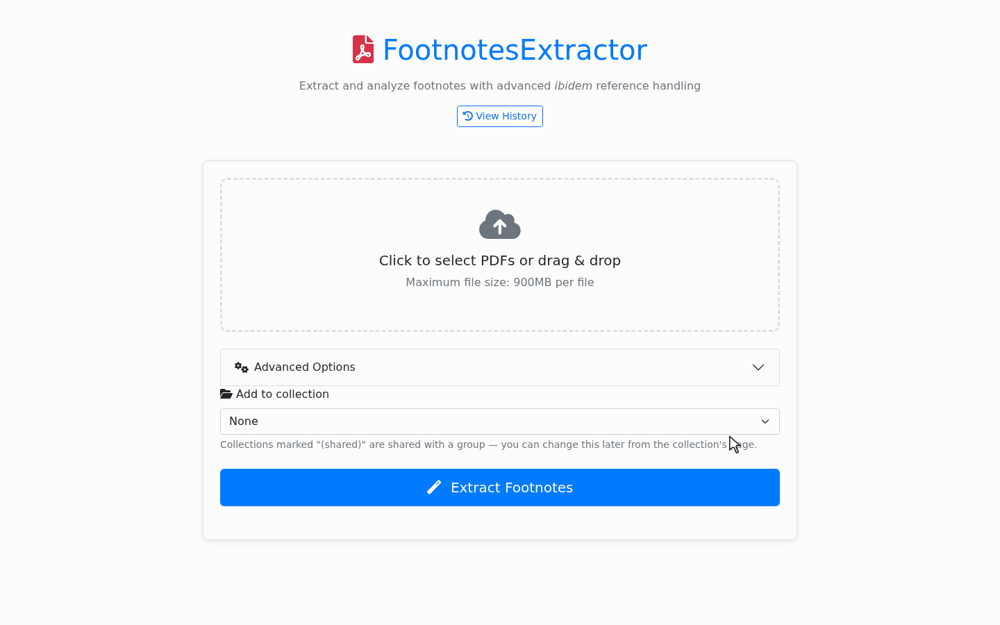
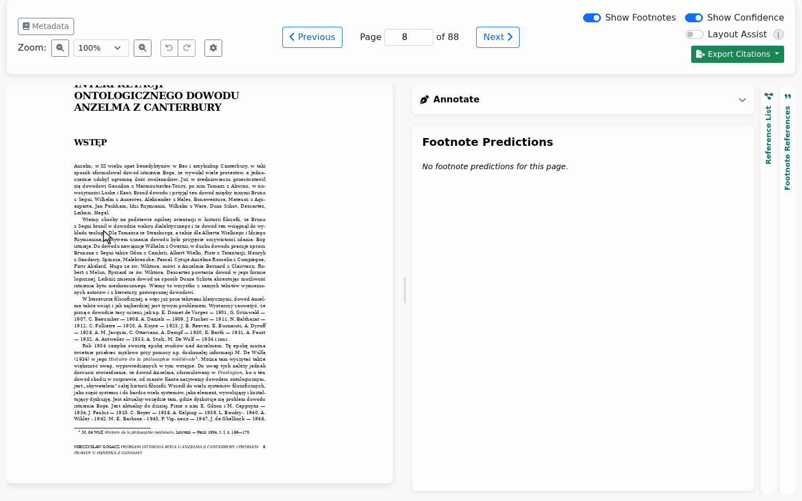
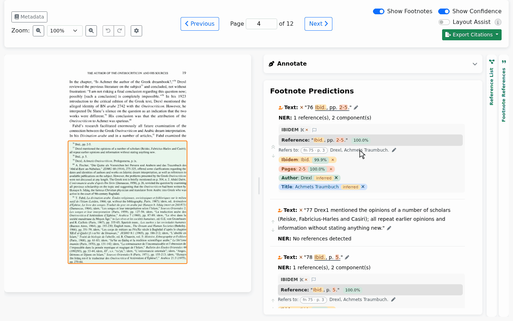
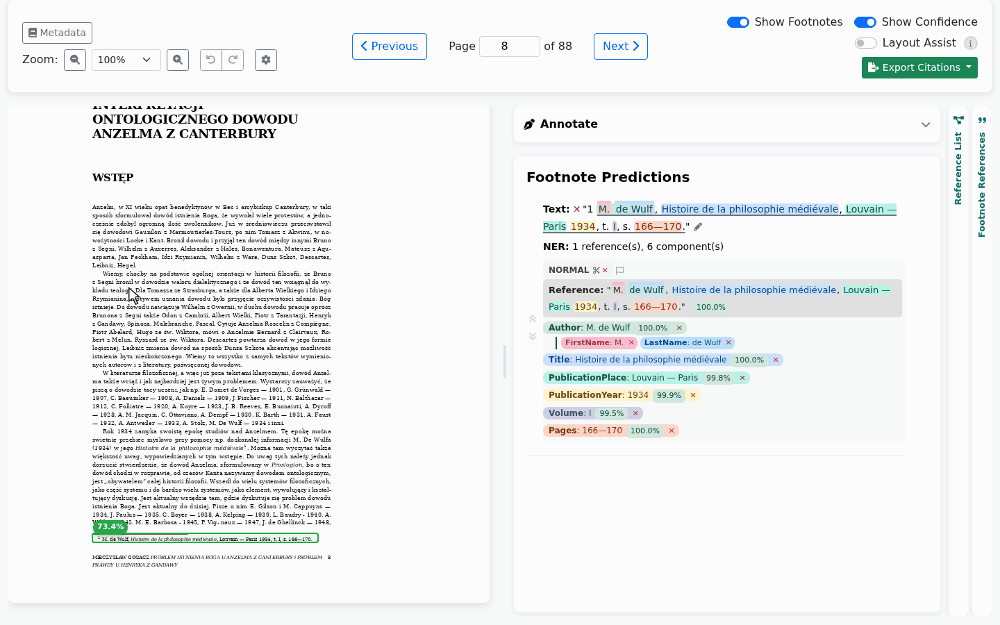

# FootnotesExtractor

An open-source, interactive system for extracting and parsing bibliographic
references from the footnotes of scholarly books and articles.

Citation indexes are built on reference lists. Books in the humanities and
social sciences cite in footnotes instead, so their references are largely
missing from the indexes. FootnotesExtractor reads a PDF, born-digital or scanned,
finds its footnotes and the references in them, tags their parts and resolves
ibid. and op. cit. A reviewer corrects anything in an interactive viewer, and the
results export as BibTeX, APA, Chicago, MLA, plain text, JSON or CSV.

**Project page:** <https://footnotesextractor.github.io/FootnotesExtractor/>
**Models:** <https://huggingface.co/FootnotesExtractor/footnotes-extractor-models>

## How it works

1. **Find footnotes:** an object detector (YOLO11-n) finds the footnote areas on each page.
2. **Read them:** text comes from the PDF's text layer or, for scans, from Surya OCR.
3. **Split them:** rules follow the footnote numbers, cut each area into single footnotes
   and rejoin notes that run over a page break.
4. **Parse references:** transformer models (XLM-R large, HerBERT large and base) find each
   reference in a footnote, tag its parts and split names into first and last name.
5. **Resolve back-references:** rules link ibid. and op. cit. to the work they refer to.

## Requirements

Minimum requirements:

| | With OCR (scans too) |
|---|---|
| GPU memory | **10 GB** |
| CPU | 4 cores |
| RAM | 12 GB |
| Disk | 6 GB |
| Speed, few footnotes | 0.3 s per page |

- **Software:** Linux and Python 3.10. The GPU must be NVIDIA: the pinned build is PyTorch 2.6
  with CUDA 12.4.

## Install

```bash
git clone https://github.com/FootnotesExtractor/FootnotesExtractor.git
cd FootnotesExtractor

python3 -m venv venv
source venv/bin/activate
pip install -r requirements.txt

python setup_models.py              # ~4 GB
FOOTNOTES_INSECURE_COOKIES=1 python wsgi.py --host 127.0.0.1     # http://127.0.0.1:5002
```

Surya downloads its own OCR weights (about 2.4 GB) the first time it runs.

`FOOTNOTES_INSECURE_COOKIES=1` lets you log in over plain HTTP on your own machine. Never set it on
a server: use HTTPS there and leave it out.

The first account you register becomes the administrator, who creates all further accounts in
**Admin → Users**.

## Use

### 1. Upload

Drop one or more PDFs on the start page, born-digital or scanned, up to 900 MB each. When
processing ends, the book opens in the viewer with every footnote boxed, read and tagged.



*A complete 88-page book. The wait is shortened here; the real run took about 3 minutes.*

### 2. Correct what is wrong

Press `B` and draw a box around a footnote the detector missed: about a second and a half later
it is read and tagged. Click a box to change it, use the pencil to fix a footnote's text, split or
merge footnotes, relabel any part, and undo any of it. Switch on **Layout Assist** for suggestions:
it learns each book's layout and citation style and points out what may be wrong.



*Real time, nothing cut.*

### 3. Check back-references

Each ibid. and op. cit. shows the work it refers to. When a rule picks the wrong one, point it to
the right one: it takes over that work's author, title and year, and the whole book is resolved again.



### 4. Export

Use the **Export Citations** button: BibTeX, APA, Chicago, MLA, the references as printed, or JSON
and CSV with everything. Each cited work appears once, with every place it is cited.



The recordings show openly licensed books: M. Gogacz, *Problem istnienia Boga u Anzelma z Canterbury
i problem prawdy u Henryka z Gandawy*, Katolicki Uniwersytet Lubelski, 1961 (CC BY-SA; steps 1, 2 and 4), and Maria V. Mavroudi, *A Byzantine Book on Dream Interpretation*,
Brill, 2002, [doi:10.1163/9789004473461](https://doi.org/10.1163/9789004473461) (CC BY; step 3).

An administrator switches optional tools on per user in **Admin → Users**, such as linking references
to a reference list given as BibTeX.

### HTTP API

Everything the web interface does is also available over HTTP. Create a key on your
**Profile** page, then:

```python
import time
import requests

BASE = "http://127.0.0.1:5002"
HEADERS = {"X-API-Key": "fnk_..."}

with open("book.pdf", "rb") as f:
    job = requests.post(f"{BASE}/api/v1/documents", headers=HEADERS,
                        files={"file": ("book.pdf", f, "application/pdf")}).json()["job_id"]

def status():
    return requests.get(f"{BASE}/api/v1/documents/{job}", headers=HEADERS).json()["status"]

while status() not in ("completed", "error"):
    time.sleep(5)

bib = requests.get(f"{BASE}/download/{job}", headers=HEADERS, params={"format": "bibtex_expanded"})
with open("book.bib", "wb") as f:
    f.write(bib.content)
```

The full reference is in [API.md](API.md).

## Configuration

All optional: the app runs with none of them set.

| Variable | Purpose |
|---|---|
| `FLASK_SECRET_KEY` | Session signing key. If unset, a random key is generated once and stored in `.secret_key` (gitignored). Set it explicitly if you run more than one instance. |
| `PORT` | Port for `wsgi.py` (default `5002`). |
| `CROSSREF_EMAIL` | Contact address for the Crossref/OpenAIRE "polite pool", which gives better rate limits during metadata enrichment. |
| `GROBID_URL` | Base URL of a GROBID server. |
| `FOOTNOTES_MODELS_REPO` | Hugging Face repo that `setup_models.py` downloads from. |
| `FOOTNOTES_INSECURE_COOKIES=1` | Allow login over plain HTTP, for trying the app on your own machine only. |
| `CUDA_VISIBLE_DEVICES=''` | Force CPU-only inference. |

## Running in production

`python app.py` starts Flask's development server and is for local work only.
`wsgi.py` serves the same app through
[waitress](https://docs.pylonsproject.org/projects/waitress/):

```bash
python wsgi.py --host 127.0.0.1 --port 5002 --threads 8
```

Bind it to loopback and put a TLS-terminating reverse proxy in front. `deploy/` holds a
Caddyfile (automatic Let's Encrypt), a self-signed variant for a bare IP, and a systemd unit;
see [deploy/DEPLOY.md](deploy/DEPLOY.md).

## Your data

Everything you process stays on your own server. The app keeps it in its own folder: your PDFs in
`uploads/`, the results in `results/`, and accounts and groups in `app.db`. Back up these to keep your
work; updating the app leaves them alone. Passwords and API keys are stored only as hashes.

## Licence

FootnotesExtractor is released under the [GNU Affero General Public License v3.0](LICENSE).
Copyright (C) 2026 the FootnotesExtractor authors.

The [model weights](https://huggingface.co/FootnotesExtractor/footnotes-extractor-models) are
released under the same licence. Some of the books used for training are under non-commercial
licences, so commercial use of the models would require retraining without them.

It relies on Ultralytics and PyMuPDF (AGPL-3.0) and Surya (GPL-3.0). Surya's model weights have
their own licence, `cc-by-nc-sa-4.0`, with a waiver for organisations below certain revenue and
funding limits: see Surya's documentation before commercial use.

## Authors and funding

- Michał Ulaniuk, National Information Processing Institute, Poland
- Emanuel Kulczycki, Humboldt-Universität zu Berlin; German Centre for Higher Education Research
  and Science Studies (DZHW)
- Przemysław Korytkowski, West Pomeranian University of Technology in Szczecin, Poland

Work co-financed by the state budget under the program of the Ministry of Education and Science
called 'Science for Society II', project no. NdS-II/SP/0460/2023/01. We gratefully acknowledge
Poland's high-performance computing infrastructure PLGrid and ACC Cyfronet AGH for providing
computational facilities and support under computational grant no. PLG/2025/018513.
