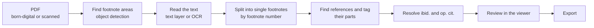

# FootnotesExtractor: overview

*[Polska wersja](../pl/README.md)*

FootnotesExtractor reads a PDF of a scholarly book or article, finds its footnotes and the
references in them, and turns the references into structured data. A reviewer checks the result
in the browser and exports it as BibTeX, APA, Chicago, MLA, plain text, JSON or CSV.

## The process

1. **Find the footnotes.** An object detector marks the footnote areas on every page.
2. **Read them.** Text comes from the PDF's own text layer or, for scans, from Surya OCR.
3. **Split them.** Rules follow the footnote numbers, cut each area into single footnotes and rejoin
   notes that run over a page break.
4. **Parse them.** Transformer models find every reference in a footnote, tag its parts (author, title,
   journal, volume, pages, year and others) and split names into first and last name.
5. **Resolve back-references.** Rules link each *ibid.* and *op. cit.* to the work it refers to. The
   reference takes over that work's author, title and year, and the whole book is resolved again after
   every edit.
6. **Review.** You correct anything that is wrong. The optional Layout Assist learns from the book and
   from your edits and points out what may be wrong.
7. **Export.** Each cited work appears once, with every place it is cited.

Everything runs on your own server. Uploaded PDFs, results and accounts stay there.

## Where to go next

- [Tutorial](tutorial.md): install the app, run it, and work through a first document.
- [What it can do](features.md): the main functions, with recordings.
- [Models](models.md): sizes, installing one, licences.
- [HTTP API](api.md): use the app from scripts.
