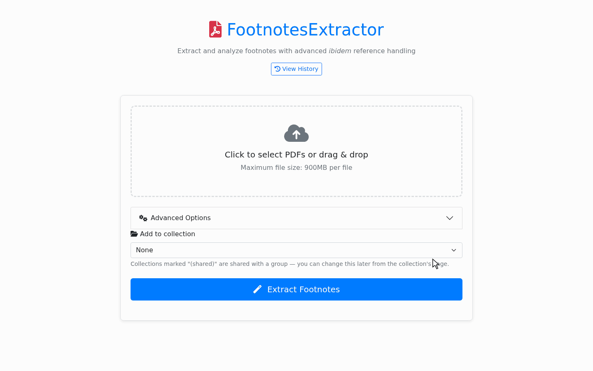
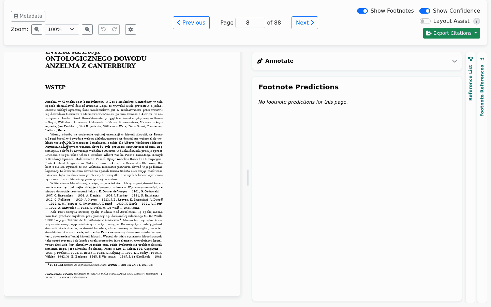
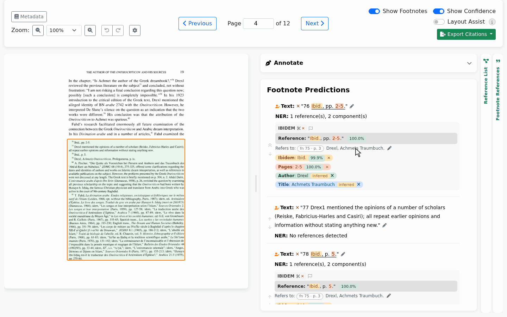
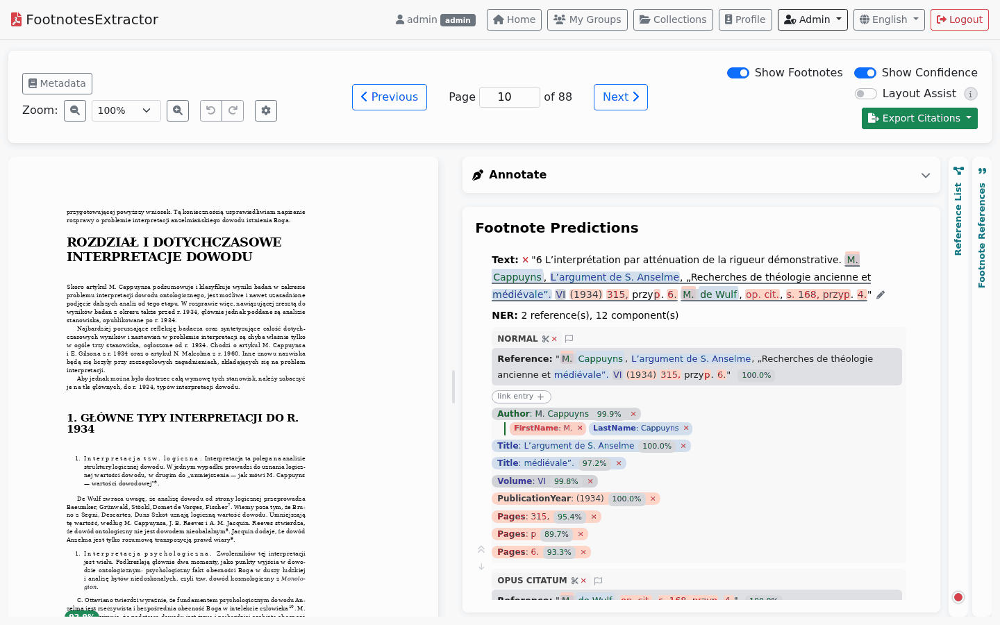
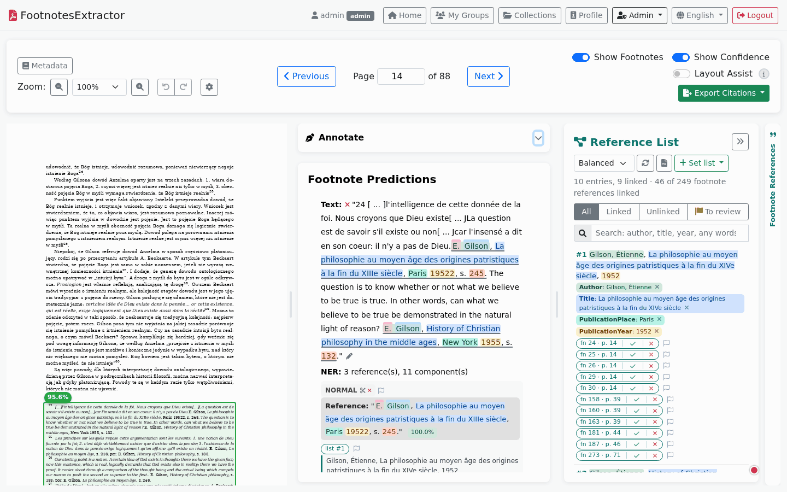
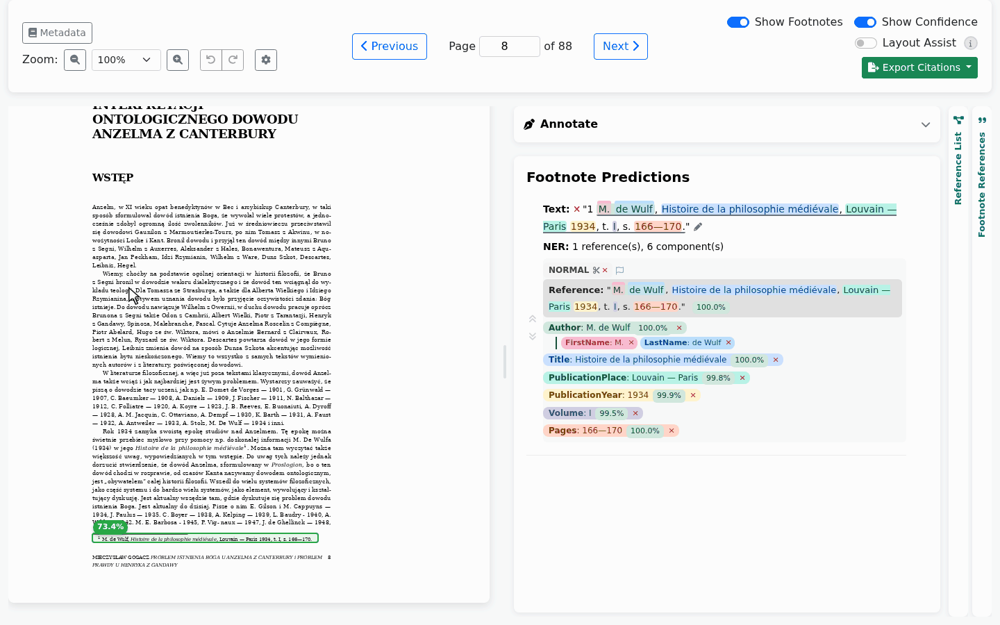

# What it can do

*[Polska wersja](../pl/features.md)*

The recordings show the real interface in real time (a long wait is shortened where noted). The books are
openly licensed: M. Gogacz, *Problem istnienia Boga u Anzelma z Canterbury i problem prawdy u Henryka z
Gandawy*, Katolicki Uniwersytet Lubelski, 1961 (CC BY-SA), and Maria V. Mavroudi, *A Byzantine Book on Dream
Interpretation*, Brill, 2002, [doi:10.1163/9789004473461](https://doi.org/10.1163/9789004473461) (CC BY;
the recording in section 3).

## 1. From PDF to references

Upload a PDF, born-digital or scanned. It is processed and opens in the viewer with every footnote boxed,
read and tagged.

*A complete 88-page book. The wait is shortened here; the real run took about 3 minutes.*

## 2. Correct anything

Draw a box around a footnote that was missed and it is read and tagged. You can also move or delete boxes,
correct the text, split and merge footnotes, change labels and undo any of it.

## 3. Back-references: ibid. and op. cit.

Each *ibid.* and *op. cit.* shows the work it refers to, and the choice can be changed. The reference takes
over that work's author, title and year, and the rest of the book follows.

## 4. Layout Assist

Layout Assist learns each book's footnote layout and citation style, from the book and from your edits. It
points to what may be wrong: a box that does not fit, a missed footnote, a label that the rest of the book
disagrees with, a part that includes too much. Each suggestion says why. You accept it or keep things as
they are, and nothing on a page you have approved is changed automatically.

*A consistency check is fixed (`315,` becomes `315`). On a later page the suggestion is wrong, because the
number is the volume of a series, and the reviewer keeps the label as it was.*

## 5. Link a reference list

Give a document a reference list as BibTeX and the app links its entries to the footnotes that cite them.
Links are found by title, author and year, and you can confirm, reject or add them by hand. A click on a
link goes to the footnote. The function is off by default: an administrator switches it on for an account
and sets the list.

*The list was prepared for the recording: ten entries, nine of them cited in the book.*

## 6. Export

Export a document, or several at once, as BibTeX, APA, Chicago, MLA, plain text or JSON. Each work appears
once, with every place it is cited.

## 7. Collections and groups

- Collections group documents; a collection can be shared with a group.
- Group members are viewers, editors or owners.
- Verified documents carry a badge.
- Several documents can be added to a collection, exported or deleted together.

## 8. Functions you can switch on

An administrator chooses, for each user, what is visible in **Admin → Users**.

| Function | Default | What it adds |
|---|---|---|
| Layout Assist | on | Suggestions, consistency checks and page approvals in the viewer |
| Advanced Options | on | Models, thresholds and processing options at upload and in the viewer |
| Show References | off | The book's own reference list, where it was found |
| Reference List Linker | off | Linking footnotes to a reference list |
| To Review | off | Marking a reference or link to come back to later |
| Metadata Enrichment | off | Looking references up in external catalogues (in development) |

When a function is off, everything that belongs to it is hidden, and its API endpoints refuse the request.

## 9. English and Polish

The interface is available in both languages; the recordings show the English one.
