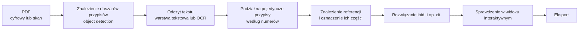

# FootnotesExtractor: opis działania

*[English version](../en/README.md)*

FootnotesExtractor czyta plik PDF książki lub artykułu naukowego, znajduje przypisy i zawarte w nich
referencje, a następnie zamienia je w dane strukturalne. Wynik sprawdza się w przeglądarce i eksportuje jako
BibTeX, APA, Chicago, MLA, zwykły tekst, JSON lub CSV.

## Przebieg

1. **Znalezienie przypisów.** Model wykrywania obiektów zaznacza obszary przypisów na każdej stronie.
2. **Odczyt.** Tekst pochodzi z warstwy tekstowej pliku PDF albo, w przypadku skanów, z Surya OCR.
3. **Podział.** Reguły śledzą numery przypisów, dzielą każdy obszar na pojedyncze przypisy i łączą przypisy
   przechodzące na kolejną stronę.
4. **Analiza referencji.** Modele typu Transformer znajdują każdą referencję w przypisie, oznaczają jej części
   (autor, tytuł, czasopismo, tom, strony, rok i inne) oraz rozdzielają imię i nazwisko.
5. **Odsyłacze wsteczne.** Reguły łączą każde *ibid.* i *op. cit.* z pracą, do której się odnosi. Referencja
   przejmuje autora, tytuł i rok tej pracy, a po każdej poprawce cała książka jest rozwiązywana od nowa.
6. **Sprawdzenie.** Każdy element można poprawić. Opcjonalny Asystent Układu uczy się z książki i z poprawek
   użytkownika i wskazuje miejsca, które mogą być błędne.
7. **Eksport.** Każda cytowana praca pojawia się raz, ze wszystkimi miejscami cytowania.

Wszystko działa na własnym serwerze. Przesłane pliki PDF, wyniki i konta na nim pozostają.

## Co dalej

- [Poradnik](tutorial.md): instalacja, uruchomienie i praca z pierwszym dokumentem.
- [Co potrafi program](features.md): główne funkcje z nagraniami.
- [HTTP API](api.md): korzystanie z programu w skryptach.
