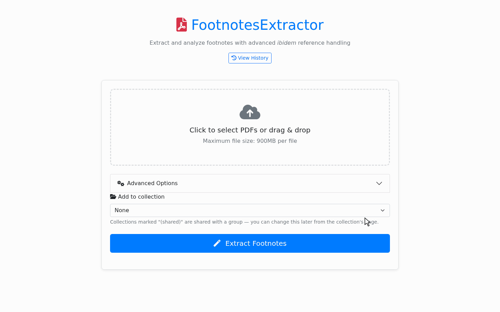
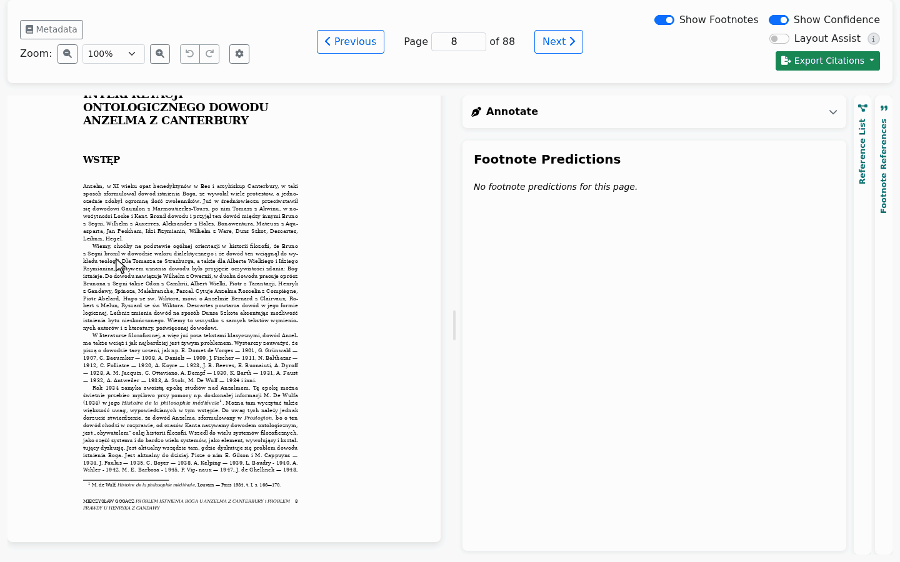
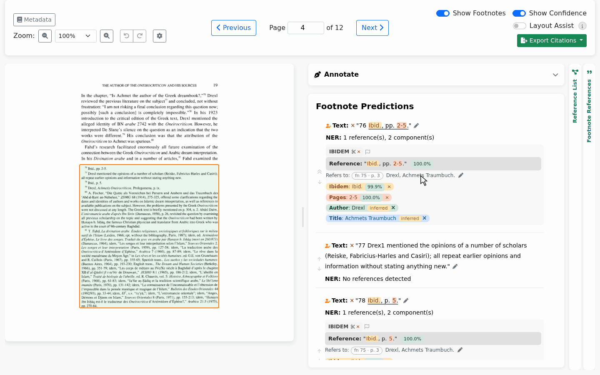
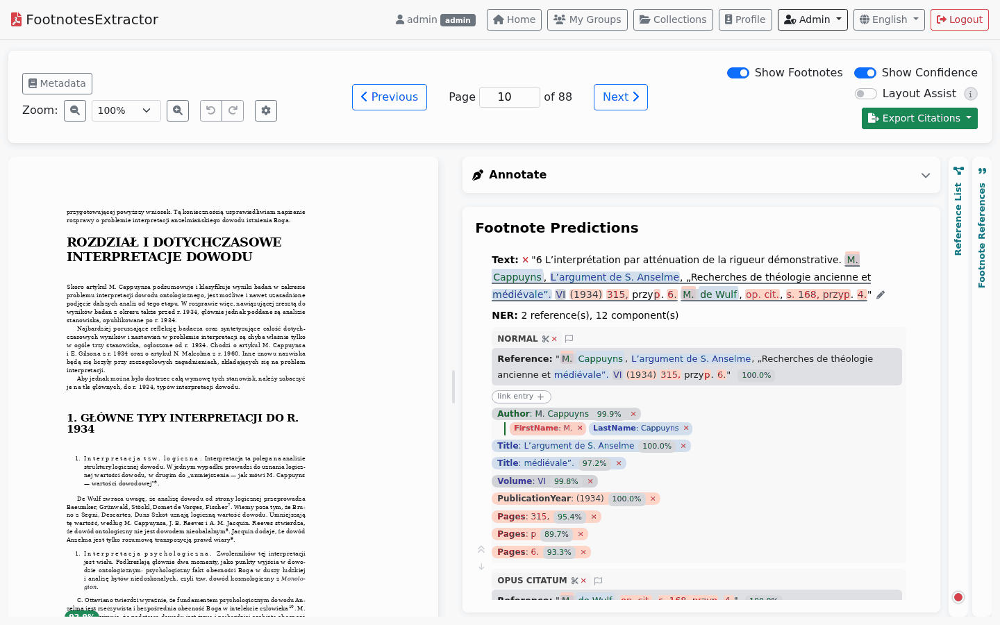
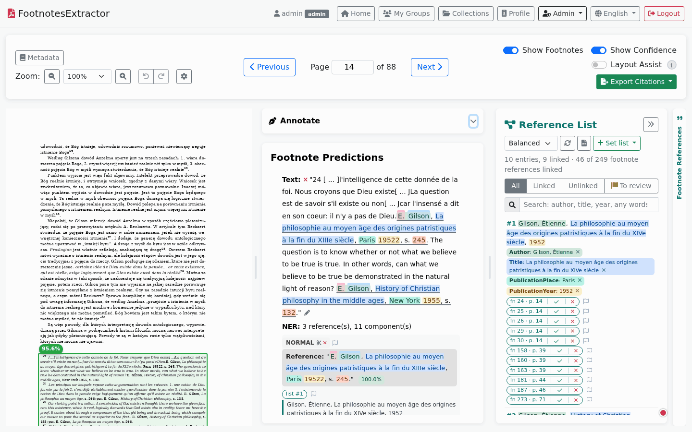
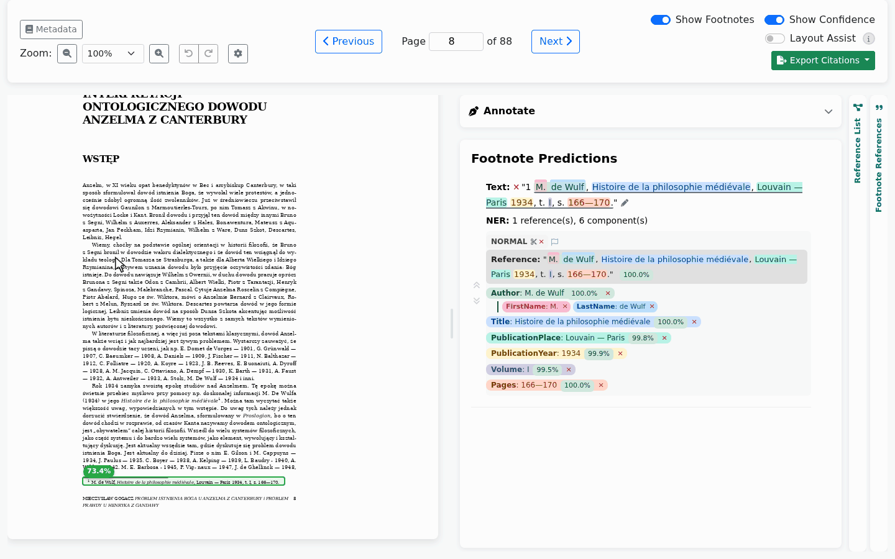

# Co potrafi program

*[English version](../en/features.md)*

Nagrania pokazują rzeczywisty interfejs w czasie rzeczywistym (długie oczekiwanie skrócono tam, gdzie to
zaznaczono). Interfejs na nagraniach jest po angielsku. Książki są na otwartych licencjach: M. Gogacz, *Problem
istnienia Boga u Anzelma z Canterbury i problem prawdy u Henryka z Gandawy*, Katolicki Uniwersytet Lubelski,
1961 (CC BY-SA) oraz Maria V. Mavroudi, *A Byzantine Book on Dream Interpretation*, Brill, 2002,
[doi:10.1163/9789004473461](https://doi.org/10.1163/9789004473461) (CC BY; nagranie w sekcji 3).

## 1. Od PDF do referencji

Przesłany plik PDF, cyfrowy lub skan, zostaje przetworzony i otwiera się w widoku interaktywnym. Każdy przypis
ma ramkę, a jego tekst jest odczytany i oznaczony.

*Cała książka, 88 stron. Oczekiwanie skrócono. W rzeczywistości trwało około 3 minut.*

## 2. Poprawianie

Ramka narysowana wokół pominiętego przypisu wystarczy, aby został odczytany i oznaczony. Można też przesuwać
i usuwać ramki, poprawiać tekst, dzielić i łączyć przypisy, zmieniać etykiety oraz cofać każdą zmianę.

## 3. Odsyłacze wsteczne: ibid. i op. cit.

Każde *ibid.* i *op. cit.* pokazuje pracę, do której się odnosi, a wybór można zmienić. Referencja przejmuje
autora, tytuł i rok tej pracy, a pozostałe odsyłacze w książce zostają przeliczone.

## 4. Asystent Układu

Asystent Układu uczy się układu przypisów i stylu cytowań danej książki, z niej samej i z poprawek
użytkownika. Wskazuje to, co może być błędne: ramkę niepasującą do układu, pominięty przypis, etykietę
odbiegającą od reszty książki, zbyt szeroko zaznaczony fragment. Przy każdej sugestii podaje powód. Użytkownik
ją przyjmuje albo zostawia stan bez zmian, a na zatwierdzonej stronie nic nie zmienia się samo.

*Poprawiona zostaje kontrola spójności (`315,` zmienia się w `315`). Na dalszej stronie sugestia jest błędna,
ponieważ liczba oznacza tom serii, więc recenzent pozostawia etykietę.*

## 5. Łączenie z bibliografią

Po podaniu bibliografii w formacie BibTeX program łączy jej pozycje z przypisami, które je cytują. Połączenia
są wyznaczane na podstawie tytułu, autora i roku, a można je potwierdzać, odrzucać i dodawać ręcznie. Kliknięcie
połączenia przenosi do przypisu. Funkcja jest domyślnie wyłączona. Administrator włącza ją dla konta i ustawia
bibliografię.

*Bibliografię przygotowano do nagrania: dziesięć pozycji, z których dziewięć jest cytowanych w książce.*

## 6. Eksport

Dokument lub kilka dokumentów naraz można wyeksportować jako BibTeX, APA, Chicago, MLA, zwykły tekst lub JSON.
Każda praca pojawia się raz, ze wszystkimi miejscami cytowania.

## 7. Kolekcje i grupy

- Kolekcje grupują dokumenty. Kolekcję można udostępnić grupie.
- Członkowie grupy są widzami, edytorami lub właścicielami.
- Zweryfikowane dokumenty mają znacznik.
- Kilka dokumentów można razem dodać do kolekcji, wyeksportować lub usunąć.

## 8. Funkcje do włączenia

Administrator wybiera w **Administrator → Użytkownicy**, co widzi każdy użytkownik.

| Funkcja | Domyślnie | Co dodaje |
|---|---|---|
| Asystent Układu | włączona | Sugestie, kontrole spójności i zatwierdzanie stron w widoku interaktywnym |
| Opcje zaawansowane | włączona | Modele, progi i opcje przetwarzania przy przesyłaniu i w widoku interaktywnym |
| Pokaż odwołania | wyłączona | Bibliografia znaleziona w samej książce |
| Łączenie bibliografii | wyłączona | Połączenie przypisów z bibliografią |
| Do przejrzenia | wyłączona | Oznaczanie referencji lub połączenia do późniejszego sprawdzenia |
| Wzbogacanie metadanych | wyłączona | Wyszukiwanie referencji w zewnętrznych katalogach (w przygotowaniu) |

Wyłączona funkcja jest ukryta w całości, a jej adresy API odmawiają wykonania żądania.

## 9. Język polski i angielski

Interfejs jest dostępny w obu językach. Na nagraniach widać wersję angielską.
